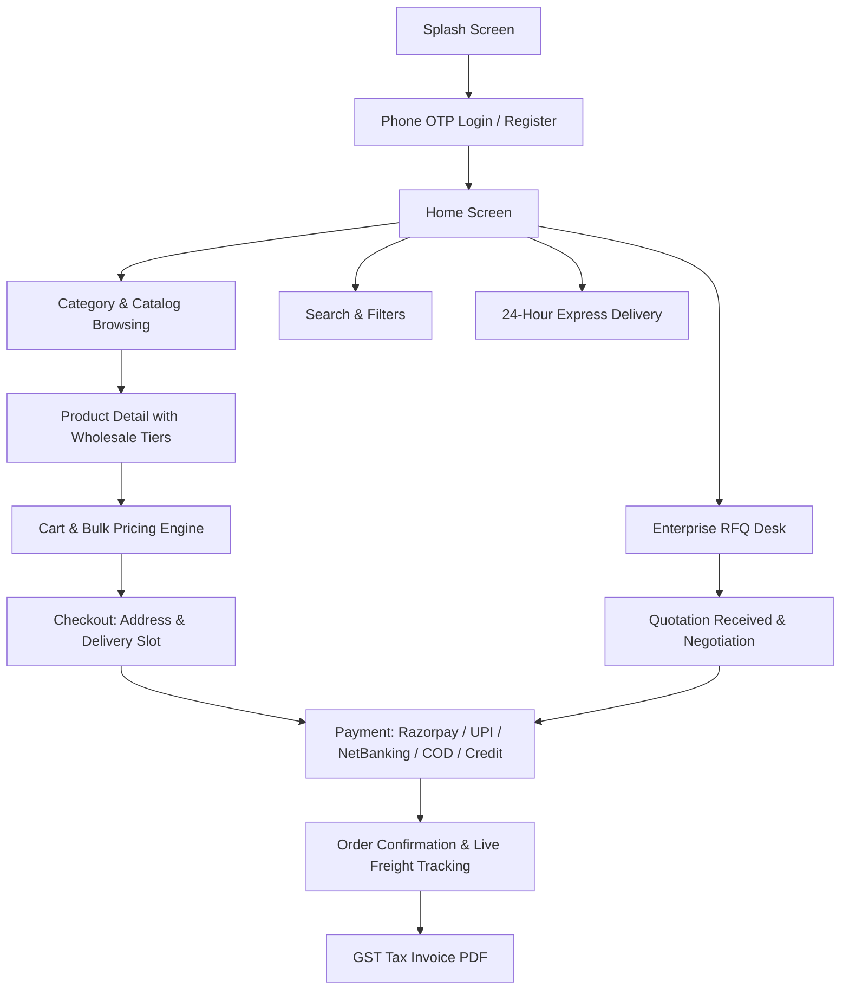

# HINCH MART — Complete Backend API Blueprint & Frontend Flow Specification

**Base URL**: `https://api.hinchmart.com/api`  
**Authentication**: `Authorization: Bearer <accessToken>` (JWT in request headers)  
**Date**: August 25, 2026  
**Audience**: Backend Development Team  

---

## 1. Global API Standards

### 1.1 Standard Success Response Envelope
All API endpoints should return responses wrapped in this standard JSON envelope:

```json
{
  "success": true,
  "message": "Operation completed successfully",
  "data": { ... },
  "timestamp": "2026-08-25T11:30:00.000Z"
}
```

### 1.2 Standard Paginated Response Envelope
For listing endpoints (products, orders, RFQs, notifications):

```json
{
  "success": true,
  "data": [ ... ],
  "pagination": {
    "page": 1,
    "limit": 20,
    "totalCount": 150,
    "totalPages": 8,
    "hasNextPage": true,
    "hasPrevPage": false
  }
}
```

### 1.3 Standard Error Response Envelope
```json
{
  "success": false,
  "message": "Validation failed / Invalid credentials",
  "statusCode": 400,
  "errors": [
    {
      "field": "phone",
      "message": "Invalid 10-digit Indian phone number."
    }
  ]
}
```

---

## 2. Complete Frontend Flow & Missing Backend APIs



---

## FLOW 1: Authentication & User Profile Management

### 1.1 Send OTP
* **Frontend Flow**: User enters 10-digit mobile number or email on `LoginScreen.tsx`.
* **Method & Endpoint**: `POST /api/auth/send-otp`
* **Request Body**:
```json
{
  "identifier": "9876543210",
  "channel": "SMS" // "SMS" | "WHATSAPP" | "EMAIL"
}
```
* **Success Response (200 OK)**:
```json
{
  "success": true,
  "message": "OTP sent successfully to +91 9876543210",
  "data": {
    "identifier": "9876543210",
    "expiresIn": 300,
    "resendAvailableIn": 30
  }
}
```

---

### 1.2 Verify OTP & Issue Session Tokens
* **Frontend Flow**: User enters the 6-digit OTP code on `OTPScreen.tsx`.
* **Method & Endpoint**: `POST /api/auth/verify-otp`
* **Request Body**:
```json
{
  "identifier": "9876543210",
  "otp": "123456",
  "fcmToken": "fcm_device_token_xyz" // Optional push notification token
}
```
* **Success Response (200 OK)**:
```json
{
  "success": true,
  "message": "OTP verified successfully",
  "data": {
    "accessToken": "eyJhbGciOiJIUzI1NiIsInR5cCI6...",
    "refreshToken": "eyJhbGciOiJIUzI1NiIsInR5cCI6...",
    "tokenType": "Bearer",
    "expiresIn": 86400,
    "user": {
      "id": 101,
      "fullName": "Rajesh Sharma",
      "phone": "9876543210",
      "email": "rajesh@apexbldrs.com",
      "role": "BUYER", // "BUYER" | "VENDOR" | "ADMIN"
      "isProfileComplete": true,
      "companyName": "Apex Infra Projects Pvt Ltd",
      "gstNumber": "36AAACT2727Q1ZW",
      "businessType": "General Contractor"
    }
  }
}
```

---

### 1.3 Complete Registration / Profile Details
* **Frontend Flow**: New user fills name, company name, GST, and business type on `RegistrationDetailsScreen.tsx`.
* **Method & Endpoint**: `POST /api/auth/register`
* **Request Body**:
```json
{
  "fullName": "Rajesh Sharma",
  "phone": "9876543210",
  "email": "rajesh@apexbldrs.com",
  "companyName": "Apex Infra Projects Pvt Ltd",
  "gstNumber": "36AAACT2727Q1ZW",
  "businessType": "General Contractor",
  "panNumber": "AAACT2727Q"
}
```
* **Success Response (201 Created)**: Returns `{ success: true, data: { user, accessToken, refreshToken } }`.

---

### 1.4 Refresh Access Token
* **Frontend Flow**: Triggered automatically by Axios interceptor when access token expires (401 response).
* **Method & Endpoint**: `POST /api/auth/refresh-token`
* **Request Body**:
```json
{
  "refreshToken": "eyJhbGciOiJIUzI1NiIsInR5cCI6..."
}
```
* **Success Response (200 OK)**:
```json
{
  "success": true,
  "data": {
    "accessToken": "eyJhbGciOiJIUzI1NiIsInR5cCI6...",
    "refreshToken": "eyJhbGciOiJIUzI1NiIsInR5cCI6...",
    "expiresIn": 86400
  }
}
```

---

### 1.5 Get User Profile & Business Details
* **Frontend Flow**: `ProfileScreen.tsx` loads user info, GST credentials, and tier status.
* **Method & Endpoint**: `GET /api/user/profile`
* **Headers**: `Authorization: Bearer <accessToken>`
* **Success Response (200 OK)**:
```json
{
  "success": true,
  "data": {
    "id": 101,
    "fullName": "Rajesh Sharma",
    "phone": "9876543210",
    "email": "rajesh@apexbldrs.com",
    "avatarUrl": "https://cdn.hinchmart.com/avatars/user_101.jpg",
    "role": "BUYER",
    "tier": "GOLD",
    "procurementStats": {
      "totalOrders": 24,
      "activeRfqs": 3,
      "wishlistItems": 12,
      "savedAddresses": 4
    },
    "business": {
      "companyName": "Apex Infra Projects Pvt Ltd",
      "gstNumber": "36AAACT2727Q1ZW",
      "panNumber": "AAACT2727Q",
      "tradeLicense": "TL-HYD-2024-9912",
      "isGstVerified": true,
      "creditLimit": 5000000.0,
      "availableCredit": 3250000.0
    }
  }
}
```

---

## FLOW 2: Product Catalog, Search & Discovery

### 2.1 Get Products with Full Search & Filtering
* **Frontend Flow**: `ProductListScreen.tsx`, `SearchScreen.tsx`, and `CategoryDetailScreen.tsx`.
* **Method & Endpoint**: `GET /api/products`
* **Query Parameters**:
  * `categoryId` *(number)*: Filter by parent category (e.g. `1`)
  * `subcategoryId` *(number)*: Filter by subcategory (e.g. `2`)
  * `search` *(string)*: Full text search across title, description, and SKU
  * `minPrice` & `maxPrice` *(number)*: Price range filter
  * `brand` *(string)*: Filter by brand name (e.g. `Tata Tiscon`, `UltraTech`)
  * `is24HourDelivery` *(boolean)*: Only items available for next-day dispatch
  * `city` / `pincode` *(string)*: Local jobsite serviceability
  * `page` & `limit` *(numbers)*: Pagination (e.g. `page=1&limit=20`)
  * `sort` *(string)*: `price_asc`, `price_desc`, `rating`, `newest`, `popular`
* **Success Response (200 OK)**:
```json
{
  "success": true,
  "data": [
    {
      "productId": 101,
      "subcategoryId": 1,
      "categoryId": 1,
      "title": "TMT Steel Rebars Fe 550D (12mm)",
      "slug": "tmt-steel-rebars-fe-550d-12mm",
      "sku": "STL-TMT-12-FE550D",
      "brand": "Tata Tiscon",
      "description": "High-ductility primary steel rebars conforming to IS 1786 standards for seismic-resistant civil structures.",
      "imageUrl": "https://cdn.hinchmart.com/products/tmt_steel_12mm.jpg",
      "images": [
        "https://cdn.hinchmart.com/products/tmt_steel_12mm_1.jpg",
        "https://cdn.hinchmart.com/products/tmt_steel_12mm_2.jpg"
      ],
      "price": 54200.0,
      "mrp": 59000.0,
      "unit": "MT",
      "moq": 5,
      "stockQty": 500,
      "active": true,
      "is24HourDelivery": true,
      "rating": 4.8,
      "reviewCount": 42,
      "gstRate": 18.0,
      "hsnCode": "7214"
    }
  ],
  "pagination": {
    "page": 1,
    "limit": 20,
    "totalCount": 85,
    "totalPages": 5
  }
}
```

---

### 2.2 Product Detail with Wholesale Bulk Tier Slabs
* **Frontend Flow**: `ProductDetailScreen.tsx` loads multi-image gallery, volume discount pricing matrix, technical specifications, and manufacturer certifications.
* **Method & Endpoint**: `GET /api/products/{id}`
* **Success Response (200 OK)**:
```json
{
  "success": true,
  "data": {
    "productId": 101,
    "title": "TMT Steel Rebars Fe 550D (12mm)",
    "slug": "tmt-steel-rebars-fe-550d-12mm",
    "sku": "STL-TMT-12-FE550D",
    "brand": "Tata Tiscon",
    "description": "High-ductility primary steel rebars conforming to IS 1786 standards.",
    "imageUrl": "https://cdn.hinchmart.com/products/tmt_steel_12mm.jpg",
    "images": [
      "https://cdn.hinchmart.com/products/tmt_steel_12mm_1.jpg",
      "https://cdn.hinchmart.com/products/tmt_steel_12mm_2.jpg",
      "https://cdn.hinchmart.com/products/tmt_steel_12mm_3.jpg"
    ],
    "price": 54200.0,
    "mrp": 59000.0,
    "unit": "MT",
    "moq": 5,
    "stockQty": 500,
    "active": true,
    "is24HourDelivery": true,
    "rating": 4.8,
    "reviewCount": 42,
    "gstRate": 18.0,
    "hsnCode": "7214",
    "specifications": {
      "Standard": "IS 1786:2008",
      "Grade": "Fe 550D",
      "Diameter": "12 mm",
      "Yield Strength": "550 N/mm²",
      "Elongation": "14.5%",
      "Manufacturer Test Certificate (MTC)": "Included per batch"
    },
    "bulkPricingTiers": [
      {
        "tierId": 1,
        "minQty": 5,
        "maxQty": 19,
        "price": 54200.0,
        "discountPercentage": 8.1
      },
      {
        "tierId": 2,
        "minQty": 20,
        "maxQty": 49,
        "price": 52800.0,
        "discountPercentage": 10.5
      },
      {
        "tierId": 3,
        "minQty": 50,
        "maxQty": null,
        "price": 51200.0,
        "discountPercentage": 13.2
      }
    ],
    "vendor": {
      "vendorId": 12,
      "companyName": "Tata Steel Distribution Yard",
      "city": "Hyderabad",
      "isVerified": true,
      "rating": 4.9
    }
  }
}
```

---

### 2.3 Search Suggestions & Auto-Complete
* **Frontend Flow**: User types in search bar on `SearchScreen.tsx`.
* **Method & Endpoint**: `GET /api/search/suggestions?q={query}`
* **Success Response (200 OK)**:
```json
{
  "success": true,
  "data": {
    "products": [
      { "productId": 101, "title": "TMT Steel 12mm", "category": "Steel" },
      { "productId": 102, "title": "TMT Steel 16mm", "category": "Steel" }
    ],
    "categories": [
      { "categoryId": 1, "name": "Civil & Structural" }
    ],
    "popularSearches": ["UltraTech Cement", "Tata Tiscon 12mm", "Armoured Cable"]
  }
}
```

---

## FLOW 3: Cart & Server-Side Real-Time Bulk Pricing Engine

### 3.1 Get User Cart
* **Frontend Flow**: `CartScreen.tsx` fetches server-side cart with real-time tax and tier price evaluation.
* **Method & Endpoint**: `GET /api/cart`
* **Headers**: `Authorization: Bearer <accessToken>`
* **Success Response (200 OK)**:
```json
{
  "success": true,
  "data": {
    "cartId": 201,
    "items": [
      {
        "cartItemId": 501,
        "productId": 101,
        "title": "TMT Steel Rebars Fe 550D (12mm)",
        "imageUrl": "https://cdn.hinchmart.com/products/tmt_steel_12mm.jpg",
        "quantity": 25,
        "unit": "MT",
        "unitPrice": 52800.0,
        "originalPrice": 54200.0,
        "appliedTier": "20-49 MT Tier (-₹1,400/MT)",
        "gstRate": 18.0,
        "lineTotal": 1320000.0,
        "lineGst": 237600.0
      }
    ],
    "subtotal": 1320000.0,
    "couponDiscount": 0.0,
    "totalGst": 237600.0,
    "deliveryCharge": 4500.0,
    "grandTotal": 1562100.0,
    "appliedCoupon": null
  }
}
```

---

### 3.2 Add / Update Item in Cart
* **Frontend Flow**: Buyer presses "Add to Cart" or modifies quantity stepper.
* **Method & Endpoint**: `POST /api/cart/items`
* **Request Body**:
```json
{
  "productId": 101,
  "quantity": 25
}
```
* **Success Response (200 OK)**: Returns the recalculated `{ success: true, data: { cartState } }`.

---

### 3.3 Apply / Remove Coupon
* **Frontend Flow**: Buyer enters promo code on `CartScreen.tsx`.
* **Method & Endpoint**: `POST /api/cart/coupon`
* **Request Body**:
```json
{
  "code": "BUILDER50K"
}
```
* **Success Response (200 OK)**:
```json
{
  "success": true,
  "message": "Coupon BUILDER50K applied: ₹50,000 off on orders above ₹10 Lakhs",
  "data": {
    "couponCode": "BUILDER50K",
    "discountAmount": 50000.0,
    "newGrandTotal": 1512100.0
  }
}
```

---

## FLOW 4: Checkout & Order Placement

### 4.1 Checkout Preview & Tax Calculation
* **Frontend Flow**: `CheckoutReviewScreen.tsx` calculates split GST (CGST/SGST/IGST) and freight based on delivery address.
* **Method & Endpoint**: `POST /api/checkout/preview`
* **Request Body**:
```json
{
  "addressId": 301,
  "deliverySlot": "TOMORROW_MORNING",
  "requiresCraneUnloading": true
}
```
* **Success Response (200 OK)**:
```json
{
  "success": true,
  "data": {
    "subtotal": 1320000.0,
    "discount": 50000.0,
    "taxableAmount": 1270000.0,
    "cgst": 114300.0, // 9%
    "sgst": 114300.0, // 9%
    "igst": 0.0,
    "totalGst": 228600.0,
    "freightCharge": 4500.0,
    "craneUnloadingCharge": 2500.0,
    "grandTotal": 1505600.0
  }
}
```

---

### 4.2 Create Order
* **Frontend Flow**: User confirms order on `CheckoutPaymentScreen.tsx`.
* **Method & Endpoint**: `POST /api/orders`
* **Request Body**:
```json
{
  "addressId": 301,
  "paymentMethod": "RAZORPAY", // "RAZORPAY" | "NEFT_RTGS" | "CREDIT_LINE" | "COD"
  "deliverySlot": "TOMORROW_MORNING",
  "deliveryInstructions": "Unload at Tower B Basement. Crane entry allowed between 6 AM - 10 AM.",
  "poNumber": "PO-2026-HYD-0044", // Optional buyer internal PO
  "requiresCraneUnloading": true
}
```
* **Success Response (201 Created)**:
```json
{
  "success": true,
  "message": "Order placed successfully",
  "data": {
    "orderId": 801,
    "orderNumber": "ORD-20260825-801",
    "totalAmount": 1505600.0,
    "paymentMethod": "RAZORPAY",
    "paymentStatus": "PENDING",
    "orderStatus": "PLACED",
    "createdAt": "2026-08-25T11:45:00Z"
  }
}
```

---

## FLOW 5: Payments (Razorpay & Verification)

### 5.1 Initiate Gateway Payment
* **Frontend Flow**: Native Razorpay SDK opens with order token.
* **Method & Endpoint**: `POST /api/payments/create`
* **Request Body**:
```json
{
  "orderId": 801
}
```
* **Success Response (201 Created)**:
```json
{
  "success": true,
  "data": {
    "paymentId": 901,
    "orderId": 801,
    "orderNumber": "ORD-20260825-801",
    "amount": 1505600.0,
    "currency": "INR",
    "amountInPaise": 150560000,
    "gatewayOrderId": "order_Rzp_20260825_801",
    "razorpayKeyId": "rzp_live_xxxxxxxxxxxx",
    "companyName": "HinchMart"
  }
}
```

---

### 5.2 Verify Payment Signature
* **Frontend Flow**: Callback from Razorpay SDK passes signature for HMAC SHA256 cryptographic verification.
* **Method & Endpoint**: `POST /api/payments/verify`
* **Request Body**:
```json
{
  "orderId": 801,
  "gatewayOrderId": "order_Rzp_20260825_801",
  "gatewayPaymentId": "pay_xxxxxxxxxxxx",
  "gatewaySignature": "e3b0c44298fc1c149afbf4c8996fb92427ae41e4649b934ca495991b7852b855"
}
```
* **Success Response (200 OK)**:
```json
{
  "success": true,
  "message": "Payment verified successfully",
  "data": {
    "orderId": 801,
    "paymentStatus": "SUCCESS",
    "transactionId": "TXN_RZP_991204",
    "paidAt": "2026-08-25T11:46:12Z"
  }
}
```

---

## FLOW 6: Order History, Live Freight Tracking & GST Invoice

### 6.1 Order List & History
* **Frontend Flow**: `OrderHistoryScreen.tsx` displays active & past orders.
* **Method & Endpoint**: `GET /api/orders`
* **Query Parameters**: `status` (`PLACED`, `CONFIRMED`, `DISPATCHED`, `DELIVERED`, `CANCELLED`), `page`, `limit`
* **Success Response (200 OK)**:
```json
{
  "success": true,
  "data": [
    {
      "orderId": 801,
      "orderNumber": "ORD-20260825-801",
      "totalAmount": 1505600.0,
      "orderStatus": "DISPATCHED",
      "paymentStatus": "PAID",
      "itemCount": 2,
      "firstItemTitle": "TMT Steel Rebars Fe 550D (12mm)",
      "firstItemImage": "https://cdn.hinchmart.com/products/tmt_steel_12mm.jpg",
      "createdAt": "2026-08-25T11:45:00Z",
      "estimatedDelivery": "2026-08-26T10:00:00Z"
    }
  ]
}
```

---

### 6.2 Live Order Tracking Checkpoints
* **Frontend Flow**: `OrderTrackingScreen.tsx` renders vertical transit progress timeline.
* **Method & Endpoint**: `GET /api/orders/{id}/tracking`
* **Success Response (200 OK)**:
```json
{
  "success": true,
  "data": {
    "orderId": 801,
    "orderNumber": "ORD-20260825-801",
    "carrierName": "VRL Logistics Heavy Freight Fleet",
    "vehicleNumber": "TS 09 UB 4412 (22-Wheel Flatbed)",
    "driverName": "Ramesh Yadav (+91 9849012345)",
    "trackingNumber": "VRL-HYD-2026-801",
    "currentStatus": "IN_TRANSIT",
    "estimatedDelivery": "2026-08-26T09:30:00Z",
    "checkpoints": [
      {
        "status": "ORDER_PLACED",
        "title": "Order Placed & Verified",
        "location": "HinchMart Hyderabad Ops",
        "timestamp": "2026-08-25T11:45:00Z",
        "description": "Order confirmed and routed to Tata Steel Distribution Hub."
      },
      {
        "status": "LOADED",
        "title": "Loaded & Weighed at Weighbridge",
        "location": "Tata Steel Distribution Bay 4",
        "timestamp": "2026-08-25T15:30:00Z",
        "description": "25 MT Gross Weight: 42.4 MT. Tare Weight: 17.4 MT. Net: 25.0 MT."
      },
      {
        "status": "IN_TRANSIT",
        "title": "Vehicle En Route to Jobsite",
        "location": "Outer Ring Road (ORR) Exit 11",
        "timestamp": "2026-08-25T18:00:00Z",
        "description": "Transit mixer / trailer moving towards Gachibowli construction site."
      }
    ]
  }
}
```

---

### 6.3 B2B GST Tax Invoice Details & Download
* **Frontend Flow**: User taps "Download GST Tax Invoice" in `OrderDetailScreen.tsx`.
* **Method & Endpoint**: `GET /api/orders/{id}/invoice`
* **Success Response (200 OK)**:
```json
{
  "success": true,
  "data": {
    "invoiceNumber": "INV-2026-000801",
    "orderNumber": "ORD-20260825-801",
    "invoiceDate": "2026-08-25",
    "sellerGstin": "36AAACH2026Q1Z1",
    "sellerLegalName": "HinchMart B2B Commerce Pvt Ltd",
    "buyerGstin": "36AAACT2727Q1ZW",
    "buyerLegalName": "Apex Infra Projects Pvt Ltd",
    "taxableAmount": 1270000.0,
    "cgst": 114300.0,
    "sgst": 114300.0,
    "igst": 0.0,
    "grandTotal": 1505600.0,
    "pdfUrl": "https://cdn.hinchmart.com/invoices/INV-2026-000801.pdf"
  }
}
```

---

## FLOW 7: Enterprise B2B Request For Quote (RFQ)

### 7.1 Submit 3-Step RFQ
* **Frontend Flow**: Contractor completes 3-step procurement form on `RFQCreateScreen.tsx`.
* **Method & Endpoint**: `POST /api/rfqs`
* **Request Body**:
```json
{
  "title": "Bulk Procurement for G+14 Commercial Tower Project",
  "category": "Steel & TMT",
  "productMaterial": "TMT Rebars Fe 550D",
  "quantity": 100,
  "unit": "MT",
  "technicalGrade": "Fe 550D Primary (Tata/JSW/Jindal)",
  "mtcRequired": true,
  "deliveryLocation": "Financial District, Gachibowli, Hyderabad - 500032",
  "requiredByDate": "2026-09-10",
  "siteAccess": "Heavy Trailer Access Available",
  "craneRequired": true,
  "targetBudget": 5100000.0,
  "paymentTerms": "LETTER_OF_CREDIT", // "LETTER_OF_CREDIT" | "ESCROW" | "30_DAYS_CREDIT" | "ADVANCE"
  "specifications": "Only secondary bend test certified rebars accepted. Delivery in 4 staggered batches of 25 MT each.",
  "boqAttachmentUrl": "https://cdn.hinchmart.com/rfq_docs/boq_project_tower_b.pdf"
}
```
* **Success Response (201 Created)**:
```json
{
  "success": true,
  "message": "RFQ created successfully and published to verified suppliers",
  "data": {
    "rfqId": 601,
    "rfqNumber": "RFQ-2026-000601",
    "status": "OPEN",
    "quotesCount": 0,
    "createdAt": "2026-08-25T11:50:00Z"
  }
}
```

---

### 7.2 Get Supplier Quotations for an RFQ
* **Frontend Flow**: `CustomerQuotationScreen.tsx` displays bids submitted by verified suppliers.
* **Method & Endpoint**: `GET /api/rfqs/{id}/quotations`
* **Success Response (200 OK)**:
```json
{
  "success": true,
  "data": [
    {
      "quoteId": 1201,
      "rfqId": 601,
      "vendorId": 45,
      "vendorName": "JSW Authorized Regional Yard",
      "unitPrice": 50800.0,
      "totalAmount": 5080000.0,
      "deliveryLeadTimeDays": 5,
      "paymentTermsOffered": "30 Days Credit / L/C accepted",
      "mtcIncluded": true,
      "freightIncluded": true,
      "validUntil": "2026-09-01T23:59:59Z",
      "vendorRating": 4.9,
      "status": "PENDING" // "PENDING" | "ACCEPTED" | "REJECTED"
    }
  ]
}
```

---

### 7.3 Accept Quotation & Convert Directly to Order
* **Frontend Flow**: Buyer taps "Accept & Proceed to Purchase" on `CustomerQuotationScreen.tsx`.
* **Method & Endpoint**: `POST /api/rfqs/quotes/{id}/accept`
* **Success Response (200 OK)**:
```json
{
  "success": true,
  "message": "Quotation accepted. Order created successfully.",
  "data": {
    "quoteId": 1201,
    "rfqId": 601,
    "orderId": 802,
    "orderNumber": "ORD-20260825-802",
    "totalAmount": 5080000.0,
    "status": "CONVERTED_TO_ORDER"
  }
}
```

---

### 7.4 RFQ Q&A / Technical Clarification
* **Frontend Flow**: `CustomerQuestionsScreen.tsx` & `AdminQuestionsScreen.tsx`.
* **Method & Endpoint**: `GET /api/rfqs/{id}/questions` & `POST /api/rfqs/{id}/questions`
* **Request Body (POST)**:
```json
{
  "question": "Can the 100 MT consignment be delivered in 4 weekly batches of 25 MT each starting Sept 1st?"
}
```
* **Success Response (201 Created)**:
```json
{
  "success": true,
  "data": {
    "questionId": 401,
    "rfqId": 601,
    "senderRole": "BUYER",
    "question": "Can the 100 MT consignment be delivered in 4 weekly batches of 25 MT each starting Sept 1st?",
    "response": "Yes, weekly dispatch schedule is accepted by supplier.",
    "status": "ANSWERED",
    "createdAt": "2026-08-25T11:55:00Z"
  }
}
```

---

## FLOW 8: User Delivery Addresses & Saved Sites

### 8.1 List Delivery Addresses / Sites
* **Frontend Flow**: `LocationPickerModal.tsx` & `CheckoutAddressScreen.tsx`.
* **Method & Endpoint**: `GET /api/user/addresses`
* **Success Response (200 OK)**:
```json
{
  "success": true,
  "data": [
    {
      "addressId": 301,
      "siteName": "Tower B Project Site",
      "recipientName": "Site Eng. Vikram Reddy",
      "phone": "9849112233",
      "addressLine1": "Plot 42, Financial District",
      "addressLine2": "Near Wave Rock",
      "city": "Hyderabad",
      "state": "Telangana",
      "pincode": "500032",
      "landmark": "Opposite ICICI Regional HQ",
      "isDefault": true,
      "hasHeavyVehicleAccess": true
    }
  ]
}
```

---

### 8.2 Add New Delivery Address
* **Method & Endpoint**: `POST /api/user/addresses`
* **Request Body**:
```json
{
  "siteName": "Tower B Project Site",
  "recipientName": "Site Eng. Vikram Reddy",
  "phone": "9849112233",
  "addressLine1": "Plot 42, Financial District",
  "city": "Hyderabad",
  "state": "Telangana",
  "pincode": "500032",
  "landmark": "Opposite ICICI Regional HQ",
  "isDefault": true,
  "hasHeavyVehicleAccess": true
}
```

---

## FLOW 9: Wishlist & Notifications

### 9.1 Sync Wishlist
* **Get Wishlist**: `GET /api/wishlist`
* **Add to Wishlist**: `POST /api/wishlist/{productId}`
* **Remove from Wishlist**: `DELETE /api/wishlist/{productId}`

---

### 9.2 Notifications
* **Get Notifications**: `GET /api/notifications`
* **Mark As Read**: `PUT /api/notifications/{id}/read`
* **Mark All As Read**: `PUT /api/notifications/read-all`
* **Register Push Notification Token**: `POST /api/notifications/push-token`
  ```json
  {
    "deviceToken": "fcm_or_apns_push_token_here",
    "platform": "ANDROID" // "ANDROID" | "IOS"
  }
  ```

---

## FLOW 10: File & Image Upload Service (Cloud Storage)

### 10.1 Upload File / Image
* **Frontend Flow**: Product image upload, BoQ PDF attachment, GST certificate upload.
* **Method & Endpoint**: `POST /api/upload/file` or `POST /api/upload/image`
* **Content-Type**: `multipart/form-data`
* **Request Form-Data**:
  * `file`: Binary file (image/jpeg, image/png, application/pdf)
  * `folder`: `products` | `rfq_docs` | `gst_certificates` | `banners`
* **Success Response (200 OK)**:
```json
{
  "success": true,
  "message": "File uploaded successfully",
  "data": {
    "fileUrl": "https://cdn.hinchmart.com/uploads/products/tmt_bar_photo.jpg",
    "fileName": "tmt_bar_photo.jpg",
    "mimeType": "image/jpeg",
    "fileSize": 1048576
  }
}
```

---

## 3. Summary Checklist for Backend Team

| Module | Endpoints Required | Priority |
|---|---|---|
| **1. Auth & Profile** | `POST /api/auth/send-otp`, `POST /api/auth/verify-otp`, `POST /api/auth/register`, `POST /api/auth/refresh-token`, `GET /api/user/profile` | **P0 (Critical)** |
| **2. Real Image Hosting** | `POST /api/upload/image`, replace `example.com` URLs with real CDN URLs | **P0 (Critical)** |
| **3. Products & Bulk Tiers** | Enhance `GET /api/products` (filters/search), `GET /api/products/{id}` (include `bulkPricingTiers` & `specifications`) | **P0 (Critical)** |
| **4. Cart & Checkout** | `GET /api/cart`, `POST /api/cart/items`, `POST /api/checkout/preview`, `POST /api/orders` | **P0 (Critical)** |
| **5. Payments (Razorpay)** | `POST /api/payments/create`, `POST /api/payments/verify` | **P0 (Critical)** |
| **6. Tracking & Invoices** | `GET /api/orders/{id}/tracking`, `GET /api/orders/{id}/invoice` | **P1 (High)** |
| **7. Enterprise RFQ** | `POST /api/rfqs`, `GET /api/rfqs`, `GET /api/rfqs/{id}/quotations`, `POST /api/rfqs/quotes/{id}/accept`, `GET/POST /api/rfqs/{id}/questions` | **P1 (High)** |
| **8. Addresses & Sites** | `GET /api/user/addresses`, `POST /api/user/addresses`, `DELETE /api/user/addresses/{id}` | **P1 (High)** |
| **9. Wishlist & Alerts** | `GET/POST/DELETE /api/wishlist`, `GET /api/notifications`, `POST /api/notifications/push-token` | **P2 (Normal)** |
