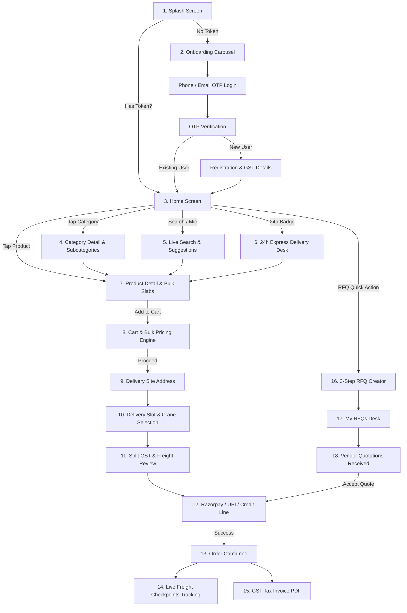

# HINCH MART — Frontend Architecture & Complete Application Flow

**Platform**: Enterprise B2B E-Commerce Mobile Application  
**Framework**: React Native 0.76+ / Expo SDK 52 (TypeScript)  
**Target OS**: Android & iOS  
**State Architecture**: Redux Toolkit + Zustand + MMKV Storage  
**Date**: August 25, 2026  

---

## 1. System Architecture Overview

The HINCH MART frontend is structured as a **modular, feature-driven, offline-resilient B2B architecture**. It decouples UI presentation, business state management, and network synchronization through clear domain layers.

```
┌────────────────────────────────────────────────────────────────────────┐
│                          PRESENTATION LAYER                            │
│   (Screens, Navigation, Atomic Components, Reanimated UI, Theme)       │
└───────────────────────────────────┬────────────────────────────────────┘
                                    │ Dispatches Actions / Subscribes
                                    ▼
┌────────────────────────────────────────────────────────────────────────┐
│                        STATE MANAGEMENT LAYER                          │
│   • Redux Toolkit: authSlice, cartSlice, wishlistSlice, themeSlice     │
│   • Zustand: locationStore, cartStore                                  │
│   • Persistent Storage: MMKV / AsyncStorage (Tokens, Preferences)      │
└───────────────────────────────────┬────────────────────────────────────┘
                                    │ Calls Domain Services
                                    ▼
┌────────────────────────────────────────────────────────────────────────┐
│                      SERVICE & API CLIENT LAYER                        │
│   • Axios Interceptors (JWT Bearer, Auto 401 Refresh, URL Formatter)   │
│   • Domain API Services (authApi, categoryApi, productApi, rfqApi)     │
│   • Normalizers & Smart Image Resolver (Validates URLs, maps fallbacks)│
└───────────────────────────────────┬────────────────────────────────────┘
                                    │ HTTPS REST JSON Requests
                                    ▼
┌────────────────────────────────────────────────────────────────────────┐
│                        HINCH MART BACKEND API                          │
│                      https://api.hinchmart.com/api                     │
└────────────────────────────────────────────────────────────────────────┘
```

---

## 2. Directory & Modular Codebase Structure

```
c:\HINCH MART\src\
├── api\                    # Domain API modules with DTO normalizers
│   ├── bannerApi.ts        # Promotional banners CRUD & caching
│   ├── categoryApi.ts      # Categories & subcategories CRUD
│   ├── productApi.ts       # Products, search, and bulk pricing
│   ├── rfqApi.ts           # Enterprise RFQ, quotes, and Q&A
│   ├── buyerApi.ts         # User flows (auth, cart, checkout, tracking)
│   └── index.ts
│
├── components\             # Reusable Atomic UI Design System
│   ├── cards\              # ProductCard, AddressCard, VendorCard
│   ├── layout\             # Screen, Header, Section, Container
│   └── ui\                 # Button, Badge, Rating, LocationPickerModal,
│                           # TwentyFourHourBadge, StatusBadge, CartToastPopup
│
├── constants\              # Configuration, endpoints & theme tokens
│   ├── api.ts              # All REST endpoint routes & timeouts
│   ├── app.ts              # App constants, onboarding slides, badges
│   ├── screens.ts          # Screen route names enum
│   └── mockData.ts         # Resilient offline fixtures
│
├── features\               # Feature-Driven Screen Modules
│   ├── auth\screens\       # SplashScreen, Onboarding, Login, OTP, Register
│   ├── home\screens\       # HomeScreen (Hero, Categories, Featured, 24h)
│   ├── products\screens\   # Categories, CategoryDetail, ProductList, Detail
│   ├── cart\screens\       # CartScreen (Bulk Slab engine, Coupons)
│   ├── checkout\screens\   # Address, Delivery, Payment, Review
│   ├── orders\screens\     # OrderHistory, OrderDetail, OrderTracking
│   ├── rfq\screens\        # RFQCreate, RFQList, RFQDetail, CustomerQuotation
│   ├── search\screens\     # SearchScreen (Live auto-complete suggestions)
│   ├── profile\screens\    # ProfileScreen, EditProfile, Wishlist, Legal
│   ├── notifications\      # NotificationsScreen
│   └── vendors\screens\    # VendorListScreen, VendorDetailScreen
│
├── hooks\                  # Custom React Hooks
│   ├── useProductsQuery.ts # Cached home data & category fetching
│   ├── useAccountSummary.ts# Procurement statistics aggregation
│   └── useDebounce.ts      # Search debouncing
│
├── navigation\             # Navigation Navigation & Route Typings
│   ├── RootNavigator.tsx   # Stack & Tab navigator orchestration
│   └── types.ts            # Strongly-typed React Navigation params
│
├── redux\                  # Redux Toolkit Global State
│   ├── slices\             # authSlice, cartSlice, wishlistSlice, themeSlice
│   ├── hooks.ts            # Typed useAppDispatch & useAppSelector
│   └── store.ts            # Root Redux store configuration
│
├── services\               # HTTP Network & Storage Services
│   ├── apiClient.ts        # Axios client with interceptors
│   ├── tokenService.ts     # Secure JWT token persistence
│   └── storage\mmkv.ts     # Fast key-value mobile storage
│
├── theme\                  # Design System Tokens
│   ├── colors.ts           # Gold, Navy, Slate, Green, Red palettes
│   ├── typography.ts       # Font scales, weights, and letter spacings
│   └── index.ts            # useTheme hook with dark/light mode
│
├── types\                  # TypeScript Domain & DTO Models
│   ├── api.types.ts        # ApiResponse, PaginatedResponse envelopes
│   ├── banner.types.ts     # Banner DTO & UI domain models
│   ├── category.types.ts   # Category & Subcategory domain models
│   ├── product.types.ts    # Product, Pricing Tiers, Specs models
│   ├── order.types.ts      # Order, Tracking, and Invoice models
│   └── rfq.types.ts        # RFQ, Quotation, and Q&A models
│
└── utils\                  # Helper Utilities
    ├── formatters.ts       # Currency (₹ INR), date, quantity formatters
    └── imageUtils.ts       # Smart CDN image resolution & fallbacks
```

---

## 3. End-to-End Application Flows



---

### Detailed Flow Descriptions

### FLOW 1: App Launch & Authentication Flow
1. **`SplashScreen.tsx`**:
   - Reads JWT tokens from `tokenService` (MMKV).
   - If a valid `accessToken` exists, calls `GET /api/user/profile` to populate Redux `authSlice` and navigates directly to `MainTabs`.
   - If no token exists, navigates to `OnboardingScreen.tsx`.
2. **`OnboardingScreen.tsx`**:
   - Displays 4 animated carousel slides highlighting Bulk Slabs, 24h Delivery, and RFQ features.
3. **`LoginScreen.tsx`**:
   - Accepts Indian 10-digit mobile number or email.
   - Calls `POST /api/auth/send-otp`.
4. **`OTPScreen.tsx`**:
   - Auto-focuses 6-digit OTP fields.
   - Calls `POST /api/auth/verify-otp`.
   - If user is missing company/GST details, navigates to `RegistrationDetailsScreen.tsx`; otherwise saves tokens and navigates to `HomeScreen.tsx`.

---

### FLOW 2: Home Screen Discovery Hub (`HomeScreen.tsx`)
1. **Location Header**: Displays live delivery site (e.g. *📍 Deliver to Financial District, Hyderabad*). Tapping opens `LocationPickerModal.tsx` to switch jobsites or query GPS location.
2. **Search Bar**: Full-width search input with voice microphone trigger that transitions to `SearchScreen.tsx`.
3. **Hero Banner Carousel**: 4.5-second auto-scrolling promo carousel. Tapping inspects `linkType` (`CATEGORY`, `PRODUCT`, `SUBCATEGORY`) and routes immediately to the target screen.
4. **Quick Action Shortcuts**:
   - *Create RFQ* ➔ `RFQCreateScreen.tsx`
   - *24h Delivery* ➔ `TwentyFourHourDeliveryScreen.tsx`
   - *Saved Items* ➔ `WishlistScreen.tsx`
   - *My Orders* ➔ `OrderHistoryScreen.tsx`
   - *All Categories* ➔ `CategoriesScreen.tsx`
5. **Shop by Category**: Compact horizontal rail of parent categories with live counts.
6. **Featured Supplies**: 2-column grid of verified construction products with discount tags, MOQ tags, and 1-tap cart buttons.

---

### FLOW 3: Catalog & Subcategory Navigation (`CategoryDetailScreen.tsx`)
1. **Vertical Subcategory Rail**: Displays left-hand rail of subcategories (e.g. *TMT Steel*, *Structural Steel*, *Binding Wires*).
2. **Product Grid**: Right-hand 2-column grid displaying products belonging to the selected subcategory.
3. **Filter & Sort Drawer**: Allows filtering by Brand, Price Range, and 24h Delivery capability.

---

### FLOW 4: Product Detail & Wholesale Pricing Matrix (`ProductDetailScreen.tsx`)
1. **Hero Multi-Media Gallery**: 3-second auto-slide carousel with full-screen pinch-to-zoom Lightbox.
2. **Verified Brand & Standard Badges**: Displays BIS Certification (`IS 1786:2008`), Grade (`Fe 550D`), and Manufacturer Test Certificate (MTC) availability.
3. **Wholesale Bulk Tier Matrix**:
   - *5 - 19 MT*: ₹54,200/MT (Base)
   - *20 - 49 MT*: ₹52,800/MT (*Save ₹1,400/MT*)
   - *50+ MT*: ₹51,200/MT (*Save ₹3,000/MT*)
4. **Interactive MOQ Stepper**: Enforces minimum order quantities and dynamically updates the applicable unit price in real time.
5. **Jobsite Delivery Estimator**: Enters pincode to calculate freight and estimated delivery slot.

---

### FLOW 5: Cart & Bulk Pricing Engine (`CartScreen.tsx`)
1. **Real-time Tier Price Calculation**: Automatically adjusts unit prices across all line items as quantities cross tier boundaries.
2. **Coupon Engine**: Accepts promo codes (e.g. `BUILDER50K`) and recalculates subtotal and tax amounts.
3. **Free Delivery Progress Bar**: Informs buyers how much additional quantity is needed for free jobsite shipping.

---

### FLOW 6: Checkout & Order Placement
1. **`CheckoutAddressScreen.tsx`**: Selects jobsite delivery address; highlights sites with heavy 22-wheel trailer access.
2. **`CheckoutDeliveryScreen.tsx`**: Chooses dispatch slot (*Next-Day 6 AM - 10 AM* or *Standard 3-Day*) and selects Crane Unloading assistance.
3. **`CheckoutReviewScreen.tsx`**: Displays detailed tax breakdown (Taxable Subtotal + CGST + SGST + IGST + Freight Surcharge).
4. **`CheckoutPaymentScreen.tsx`**: Selects payment method (*Razorpay Online*, *NEFT/RTGS Transfer*, *30-Day Credit Line*, or *Cash on Delivery*).

---

### FLOW 7: Razorpay Payment Integration
1. Calls `POST /api/payments/create` with `orderId` to generate a Razorpay order token.
2. Opens native Razorpay checkout sheet.
3. On payment success, calls `POST /api/payments/verify` with `gatewayOrderId`, `gatewayPaymentId`, and `gatewaySignature` for server-side HMAC-SHA256 signature verification.
4. Navigates to `OrderConfirmationScreen.tsx`.

---

### FLOW 8: Order Management, Live Tracking & Invoices
1. **`OrderHistoryScreen.tsx`**: Categorizes orders into *Active*, *Delivered*, and *Cancelled*.
2. **`OrderTrackingScreen.tsx`**: Shows vertical progress timeline:
   - *Manifested at Pune Central Yard*
   - *Loaded on 22-Wheel Flatbed Trailer (Weighbridge Gross: 42.4 MT / Net: 25.0 MT)*
   - *In Transit via Outer Ring Road*
   - *Delivered at Jobsite*
3. **`OrderDetailScreen.tsx`**: Displays B2B GST tax invoice breakdown and provides a 1-tap button to download the PDF invoice.

---

### FLOW 9: Enterprise B2B RFQ (Request For Quote)
1. **`RFQCreateScreen.tsx`** (3-Step Form):
   - *Step 1*: Material Name, Category, Quantity, Unit, Grade & MTC requirement.
   - *Step 2*: Jobsite Location, Required-By Date, Heavy Vehicle Access, and Crane Unloading toggle.
   - *Step 3*: Target Budget, Payment Terms (L/C, Escrow, Credit), and BoQ PDF attachment.
2. **`CustomerQuotationScreen.tsx`**:
   - Displays bids submitted by authorized regional suppliers with price per unit, delivery lead time, and validity.
   - Tapping "Accept Quotation" converts the RFQ directly into a purchase order (`POST /api/rfqs/quotes/{id}/accept`).
3. **`CustomerQuestionsScreen.tsx`**:
   - Direct Q&A channel between buyer and supplier for technical clarifications (e.g. batch delivery schedules).

---

### FLOW 10: Account & Profile Management (`ProfileScreen.tsx`)
1. **Hero Profile Card**: Displays user name, company name, GST status, and Gold Tier badge.
2. **Procurement Quadrant**: Quick counters for Total Orders, Active RFQs, Wishlist Items, and Saved Addresses.
3. **Settings & Preferences**:
   - Theme Mode Toggle (Dark / Light).
   - Multi-Language Switcher (English, Hindi, Arabic).
   - Edit Profile & GST Number Modal.
   - Safe Redux Logout dialogue.

---

## 4. Key State Management Modules

| Store / Slice | Scope | Primary State Managed |
|---|---|---|
| **`authSlice`** | Redux | `user`, `accessToken`, `refreshToken`, `isAuthenticated`, `isOnboardingComplete` |
| **`cartSlice`** | Redux | `items`, `subtotal`, `gstTotal`, `deliveryCharge`, `appliedCoupon`, `grandTotal` |
| **`wishlistSlice`** | Redux | `wishlistItems: Product[]`, `isWishlisted(productId)` |
| **`themeSlice`** | Redux | `themeMode: 'light' \| 'dark' \| 'system'` |
| **`locationStore`** | Zustand | `selectedSite: DeliverySite`, `userCoordinates`, `serviceablePincodes` |
| **`tokenService`** | MMKV | High-speed encrypted JWT storage and retrieval |
