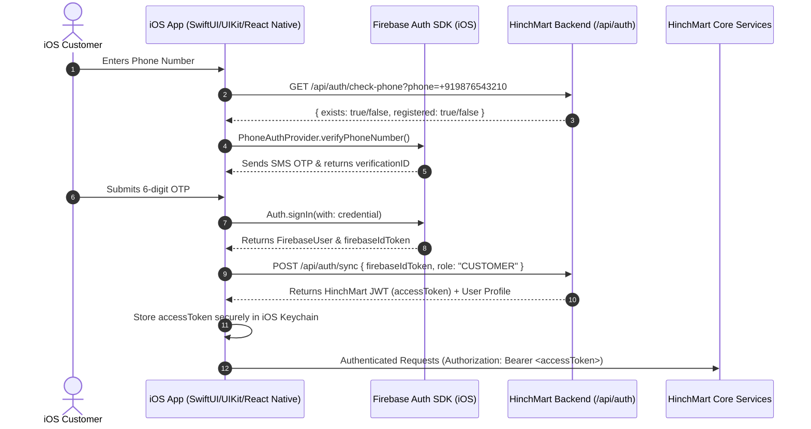

# HinchMart iOS Customer App — Complete API & Integration Specification

This document is the end-to-end integration reference for building and verifying the **HinchMart iOS Customer App**. It covers all customer-facing endpoints, Firebase-to-JWT authentication, cart & checkout pricing recomputations, Razorpay mobile payment flows, live order tracking, and Swift `Codable` models.

---

## 1. Global iOS Networking & Security Conventions

- **Base URL:**
  - Production: `https://api.hinchmart.com`
  - Staging / Local Simulator: `http://localhost:8080` (or `http://10.0.2.2:8080` for network bridges)
- **Standard HTTP Headers:**
  ```http
  Authorization: Bearer <HINCHMART_ACCESS_TOKEN>
  Content-Type: application/json
  Accept: application/json
  ```
- **Response Wrapper Envelope (`ApiResponse<T>`):**
  All successful JSON endpoints return:
  ```json
  {
    "success": true,
    "statusCode": 200,
    "message": "Operation completed successfully",
    "data": { ... },
    "pagination": {
      "page": 1,
      "limit": 20,
      "totalRecords": 45,
      "totalPages": 3
    },
    "timestamp": "2026-10-31T11:55:00.000Z"
  }
  ```
- **Error Response Envelope (`400`, `401`, `403`, `404`, `429`, `500`):**
  ```json
  {
    "success": false,
    "statusCode": 400,
    "message": "Request payload failed validation checks",
    "errors": [
      {
        "field": "phone",
        "message": "Phone must be a valid 10-digit Indian mobile number"
      }
    ],
    "timestamp": "2026-10-31T11:55:00.000Z"
  }
  ```

---

## 2. iOS Customer App Architecture Flow



---

## 3. Detailed Endpoint Matrix by Customer Journey

---

### Journey 1: Authentication & Session Management (Firebase & JWT)

**Primary Controller:** `AuthController.java`

#### 1.1 Pre-Login Phone Verification Check
*Verify whether the customer already exists in HinchMart database prior to triggering SMS OTP.*
- **Method:** `GET`
- **Path:** `/api/auth/check-phone?phone=+919876543210`
- **Auth:** Public
- **Rate Limit:** 10 requests / minute / IP
- **Request Body:** *None*
- **Response (`200 OK`):**
  ```json
  {
    "success": true,
    "statusCode": 200,
    "message": "Phone check completed",
    "data": {
      "exists": true,
      "phone": "+919876543210",
      "registered": true,
      "role": "CUSTOMER",
      "name": "Karthik Verma",
      "sellerId": null
    }
  }
  ```

#### 1.2 Exchange Firebase Token for HinchMart JWT (User Sync)
*Call immediately after Firebase Auth completes (Phone OTP, Apple ID, or Google Sign-In) to obtain the backend HinchMart JWT.*
- **Method:** `POST`
- **Path:** `/api/auth/sync`
- **Auth:** Public
- **Request Body:**
  ```json
  {
    "firebaseIdToken": "eyJhbGciOiJSUzI1NiIsImtpZCI6Ij...",
    "role": "CUSTOMER",
    "name": "Karthik Verma",
    "email": "karthik@example.com",
    "phone": "+919876543210"
  }
  ```
- **Response (`200 OK`):**
  ```json
  {
    "success": true,
    "statusCode": 200,
    "message": "User synchronized successfully",
    "data": {
      "accessToken": "eyJhbGciOiJIUzI1NiIsInR5cCI6IkpXVCJ9...",
      "tokenType": "Bearer",
      "expiresIn": 86400,
      "token": "eyJhbGciOiJIUzI1NiIsInR5cCI6IkpXVCJ9...",
      "userId": 42,
      "firebaseUid": "pZ9vT3yX7wA1b8cD4e",
      "name": "Karthik Verma",
      "email": "karthik@example.com",
      "phone": "+919876543210",
      "role": "CUSTOMER",
      "sellerId": null,
      "isProfileComplete": true,
      "customer": {
        "customerId": 42,
        "firebaseUid": "pZ9vT3yX7wA1b8cD4e",
        "name": "Karthik Verma",
        "email": "karthik@example.com",
        "phone": "+919876543210",
        "role": "CUSTOMER"
      }
    }
  }
  ```

#### 1.3 Verify Current Session & Profile Details
*Call on app cold launch to test if stored Keychain token is valid.*
- **Method:** `GET`
- **Path:** `/api/auth/me`
- **Headers:** `Authorization: Bearer <accessToken>`
- **Response (`200 OK`):**
  ```json
  {
    "success": true,
    "statusCode": 200,
    "data": {
      "userId": 42,
      "firebaseUid": "pZ9vT3yX7wA1b8cD4e",
      "name": "Karthik Verma",
      "email": "karthik@example.com",
      "phone": "+919876543210",
      "role": "CUSTOMER",
      "isProfileComplete": true
    }
  }
  ```

#### 1.4 Refresh Token
- **Method:** `POST`
- **Path:** `/api/auth/refresh-token`
- **Headers:** `Authorization: Bearer <accessToken>`
- **Request Body (Optional):**
  ```json
  {
    "token": "eyJhbGciOiJIUzI1NiIsInR5cCI6IkpXVCJ9..."
  }
  ```
- **Response (`200 OK`):** Returns refreshed `AuthUserResponse` with new expiration.

#### 1.5 Logout
- **Method:** `POST`
- **Path:** `/api/auth/logout`
- **Headers:** `Authorization: Bearer <accessToken>`
- **Response (`200 OK`):**
  ```json
  {
    "success": true,
    "message": "Logged out successfully",
    "data": { "success": true }
  }
  ```

---

### Journey 2: Customer Profile & Delivery Address Book

**Primary Controllers:** `UserProfileController.java`, `AddressController.java`

#### 2.1 Get Customer Profile
- **Method:** `GET`
- **Path:** `/api/user/profile`
- **Headers:** `Authorization: Bearer <accessToken>`
- **Response (`200 OK`):**
  ```json
  {
    "success": true,
    "statusCode": 200,
    "data": {
      "userId": 42,
      "firebaseUid": "pZ9vT3yX7wA1b8cD4e",
      "name": "Karthik Verma",
      "email": "karthik@example.com",
      "phone": "+919876543210",
      "role": "CUSTOMER",
      "active": true,
      "createdAt": "2026-09-15T10:00:00",
      "updatedAt": "2026-10-25T14:30:00"
    }
  }
  ```

#### 2.2 Update Customer Profile
- **Method:** `PUT`
- **Path:** `/api/user/profile`
- **Headers:** `Authorization: Bearer <accessToken>`
- **Request Body:**
  ```json
  {
    "name": "Karthik V. Verma",
    "email": "karthik.verma@example.com",
    "phone": "+919876543210"
  }
  ```
- **Response (`200 OK`):** Updated `UserProfileResponse`.

#### 2.3 List Delivery Addresses
- **Method:** `GET`
- **Path:** `/api/addresses` (or `/api/user/addresses`)
- **Headers:** `Authorization: Bearer <accessToken>`
- **Response (`200 OK`):**
  ```json
  {
    "success": true,
    "statusCode": 200,
    "data": [
      {
        "id": 105,
        "siteName": "Emerald Heights Construction Site",
        "recipientName": "Site Supervisor Manoj",
        "phone": "+919822334455",
        "addressLine1": "Plot 14, Sector 18",
        "addressLine2": "Near D-Mart",
        "houseFlatNo": "Gate 2",
        "areaLocality": "Kharghar",
        "city": "Navi Mumbai",
        "state": "Maharashtra",
        "country": "India",
        "pincode": "410210",
        "landmark": "Opposite Metro Pillar 42",
        "latitude": 19.0435,
        "longitude": 73.0682,
        "addressType": "SITE",
        "isDefault": true,
        "hasHeavyVehicleAccess": true,
        "createdAt": "2026-10-10T11:00:00"
      }
    ]
  }
  ```

#### 2.4 Add New Delivery Address
- **Method:** `POST`
- **Path:** `/api/addresses`
- **Headers:** `Authorization: Bearer <accessToken>`
- **Request Body:**
  ```json
  {
    "siteName": "Emerald Heights Site",
    "recipientName": "Manoj Kumar",
    "phone": "9822334455",
    "addressLine1": "Plot 14, Sector 18",
    "addressLine2": "Near D-Mart",
    "houseFlatNo": "Gate 2",
    "areaLocality": "Kharghar",
    "city": "Navi Mumbai",
    "state": "Maharashtra",
    "country": "India",
    "pincode": "410210",
    "landmark": "Opposite Metro Pillar 42",
    "latitude": 19.0435,
    "longitude": 73.0682,
    "addressType": "SITE",
    "isDefault": true,
    "hasHeavyVehicleAccess": true
  }
  ```
- **Allowed `addressType` values:** `HOME`, `WORK`, `SITE`, `WAREHOUSE`, `OTHER`
- **Response (`201 Created`):** Returns created `AddressResponse`.

#### 2.5 Update Delivery Address
- **Method:** `PUT`
- **Path:** `/api/addresses/{id}`
- **Headers:** `Authorization: Bearer <accessToken>`
- **Request Body:** Same schema as `AddressRequest`.
- **Response (`200 OK`):** Updated `AddressResponse`.

#### 2.6 Set Default Address
- **Method:** `PATCH`
- **Path:** `/api/addresses/{id}/default`
- **Headers:** `Authorization: Bearer <accessToken>`
- **Response (`200 OK`):** Updated `AddressResponse` with `isDefault = true`.

#### 2.7 Delete Address
- **Method:** `DELETE`
- **Path:** `/api/addresses/{id}`
- **Headers:** `Authorization: Bearer <accessToken>`
- **Response (`200 OK`):** `{ "success": true, "message": "Address deleted successfully", "data": null }`.

---

### Journey 3: Location Geocoding & Dark Store Serviceability

**Primary Controllers:** `LocationController.java`, `ServiceabilityController.java`, `StoreController.java`

#### 3.1 Reverse-Geocode GPS Coordinates to Structured Address
*Called after iOS prompts CoreLocation (`CLLocationManager`) permissions.*
- **Method:** `POST`
- **Path:** `/api/location/reverse-geocode`
- **Auth:** Public
- **Request Body:**
  ```json
  {
    "latitude": 19.1136,
    "longitude": 72.8697
  }
  ```
- **Response (`200 OK`):**
  ```json
  {
    "success": true,
    "statusCode": 200,
    "message": "Location resolved successfully",
    "data": {
      "latitude": 19.1136,
      "longitude": 72.8697,
      "formattedAddress": "Andheri East, Mumbai, Maharashtra 400069",
      "addressLine1": "Near Western Express Highway",
      "addressLine2": "Andheri East",
      "area": "Andheri East",
      "city": "Mumbai",
      "state": "Maharashtra",
      "country": "India",
      "pincode": "400069"
    }
  }
  ```

#### 3.2 Check Serviceability by Pincode
- **Method:** `GET`
- **Path:** `/api/serviceability/check?pincode=400069`
- **Auth:** Public
- **Response (`200 OK`):**
  ```json
  {
    "success": true,
    "statusCode": 200,
    "message": "Serviceability checked successfully",
    "pincode": "400069",
    "city": "Mumbai",
    "state": "Maharashtra",
    "serviceable": true,
    "estimatedDays": 1,
    "isExpressAvailable": true,
    "area": "Andheri East",
    "district": "Mumbai Suburban"
  }
  ```

#### 3.3 List Active Dark Stores (Quick-Commerce Hubs)
*Find stores fulfilling the customer's delivery zone.*
- **Method:** `GET`
- **Path:** `/api/stores?search=mumbai&page=1&limit=10`
- **Auth:** Public
- **Response (`200 OK`):**
  ```json
  {
    "success": true,
    "data": [
      {
        "storeId": 3,
        "name": "HinchExpress Andheri Dark Store",
        "slug": "hinchexpress-andheri-hub",
        "logoUrl": "https://storage.hinchmart.com/stores/andheri-logo.png",
        "bannerUrl": "https://storage.hinchmart.com/stores/andheri-banner.jpg",
        "description": "Express 60-minute delivery for hardware, cement and tools.",
        "status": "ACTIVE",
        "minOrderValue": 250.00,
        "serviceRadiusKm": 7,
        "latitude": 19.1136,
        "longitude": 72.8697,
        "rating": 4.9,
        "reviewCount": 340
      }
    ]
  }
  ```

---

### Journey 4: Home Feed, Catalog Browsing & Search

**Primary Controllers:** `BannerController.java`, `HomeHotDealController.java`, `CategoryController.java`, `ProductController.java`, `SearchController.java`

#### 4.1 Home Screen Promotional Banners
- **Method:** `GET`
- **Path:** `/api/banners?active=true&position=HOME_HERO`
- **Auth:** Public
- **Response (`200 OK`):**
  ```json
  {
    "success": true,
    "statusCode": 200,
    "data": [
      {
        "id": 1,
        "title": "Mega Monsoon Steel & Cement Sale",
        "subtitle": "Flat ₹5,000 off on bulk orders above 5 Tons",
        "imageUrl": "https://storage.hinchmart.com/banners/hero1.jpg",
        "linkUrl": "/category/cement-and-steel",
        "position": "HOME_HERO",
        "sortOrder": 1,
        "active": true
      }
    ]
  }
  ```

#### 4.2 Home Screen Hot Deals / Flash Sale Carousel
- **Method:** `GET`
- **Path:** `/api/home/hot-deals`
- **Auth:** Public
- **Response (`200 OK`):**
  ```json
  {
    "success": true,
    "statusCode": 200,
    "data": {
      "title": "Today's Express Hot Deals",
      "deals": [
        {
          "id": 12,
          "productId": 204,
          "displayOrder": 1,
          "active": true,
          "product": {
            "productId": 204,
            "title": "UltraTech Super Cement PPC 50kg Bag",
            "slug": "ultratech-super-cement-ppc-50kg",
            "sku": "CEM-ULT-050",
            "price": 420.00,
            "sellingPrice": 360.00,
            "mrp": 450.00,
            "discountPercentage": 20.0,
            "unit": "BAG",
            "imageUrl": "https://storage.hinchmart.com/products/cement.jpg",
            "inStock": true,
            "stockQty": 250,
            "is24HourDelivery": true,
            "rating": 4.8,
            "reviewCount": 112
          }
        }
      ]
    }
  }
  ```

#### 4.3 Master Taxonomy Categories
- **Method:** `GET`
- **Path:** `/api/categories/website?includeSubcategories=true&page=1`
- **Auth:** Public
- **Response (`200 OK`):**
  ```json
  {
    "success": true,
    "statusCode": 200,
    "data": [
      {
        "id": 3,
        "name": "Steel & Structural Rebars",
        "slug": "steel-and-structural-rebars",
        "imageUrl": "https://storage.hinchmart.com/categories/steel.png",
        "subcategories": [
          {
            "id": 12,
            "name": "TMT Rebars (Fe550D)",
            "slug": "tmt-rebars-fe550d",
            "imageUrl": "https://storage.hinchmart.com/subcategories/tmt.png"
          }
        ]
      }
    ]
  }
  ```

#### 4.4 Product Catalog Listing (with Filters, Pagination & Sorting)
- **Method:** `GET`
- **Path:** `/api/products?categoryId=3&subcategoryId=12&is24HourDelivery=true&sort=price_asc&page=1&limit=20`
- **Query Parameters:**
  - `categoryId`: Filter by category ID
  - `subcategoryId`: Filter by subcategory ID
  - `brandId`: Filter by brand ID
  - `search`: Keyword search
  - `minPrice`, `maxPrice`: Numeric price bounds
  - `is24HourDelivery`: `true` for hyper-local quick commerce items
  - `sort`: `newest`, `price_asc`, `price_desc`, `rating`, `popular`
  - `page`, `limit`: Pagination parameters (default: `1`, `20`)
- **Response (`200 OK`):**
  ```json
  {
    "success": true,
    "statusCode": 200,
    "pagination": { "page": 1, "limit": 20, "totalRecords": 35, "totalPages": 2 },
    "data": [
      {
        "productId": 310,
        "title": "Kamdhenu Fe550D TMT Steel Rebar 12mm",
        "slug": "kamdhenu-fe550d-tmt-rebar-12mm",
        "sku": "TMT-KAM-12MM",
        "description": "High-ductility earthquake-resistant structural TMT bar.",
        "price": 62000.00,
        "sellingPrice": 59500.00,
        "mrp": 65000.00,
        "discountPercentage": 8.46,
        "unit": "TON",
        "weightKg": 1000.00,
        "moq": 1,
        "stockQty": 40,
        "availableQty": 40,
        "inStock": true,
        "is24HourDelivery": true,
        "gstRate": 18.0,
        "hsnCode": "72142090",
        "imageUrl": "https://storage.hinchmart.com/products/tmt-12mm.jpg",
        "images": [
          "https://storage.hinchmart.com/products/tmt-12mm.jpg",
          "https://storage.hinchmart.com/products/tmt-12mm-test.jpg"
        ],
        "bulkPricingTiers": [
          { "minQty": 5, "maxQty": 19, "discountPrice": 58000.00, "discountPercentage": 2.5 },
          { "minQty": 20, "maxQty": 999, "discountPrice": 56000.00, "discountPercentage": 5.8 }
        ]
      }
    ]
  }
  ```

#### 4.5 Product Details by ID
- **Method:** `GET`
- **Path:** `/api/products/{id}`
- **Auth:** Public
- **Response (`200 OK`):** Single `ProductResponse` with complete specifications and bulk tiers.

#### 4.6 Instant Search & Auto-Complete Suggestions
*Used for the search bar typeahead dropdown.*
- **Method:** `GET`
- **Path:** `/api/search/suggestions?q=tmt`
- **Auth:** Public
- **Response (`200 OK`):**
  ```json
  {
    "success": true,
    "statusCode": 200,
    "data": {
      "query": "tmt",
      "suggestions": [
        "Kamdhenu Fe550D TMT Steel Rebar 12mm",
        "Tata Tiscon 550D TMT Rebar 16mm"
      ],
      "categories": [
        { "id": 3, "name": "Steel & Structural Rebars", "slug": "steel-and-structural-rebars" }
      ],
      "brands": [
        { "id": 5, "name": "Kamdhenu" },
        { "id": 8, "name": "Tata Tiscon" }
      ]
    }
  }
  ```

---

### Journey 5: Cart Management & Store Binding

**Primary Controller:** `CartController.java`

#### 5.1 Get Customer Cart
- **Method:** `GET`
- **Path:** `/api/cart`
- **Headers:** `Authorization: Bearer <accessToken>`
- **Response (`200 OK`):**
  ```json
  {
    "success": true,
    "statusCode": 200,
    "message": "Cart retrieved successfully",
    "data": {
      "cartId": 89,
      "storeId": 3,
      "storeName": "HinchExpress Andheri Dark Store",
      "storeSlug": "hinchexpress-andheri-hub",
      "items": [
        {
          "cartItemId": 210,
          "productId": 310,
          "title": "Kamdhenu Fe550D TMT Steel Rebar 12mm",
          "imageUrl": "https://storage.hinchmart.com/products/tmt-12mm.jpg",
          "quantity": 2,
          "unit": "TON",
          "unitPrice": 59500.00,
          "originalPrice": 62000.00,
          "appliedTier": "STANDARD",
          "gstRate": 18.0,
          "lineTotal": 119000.00,
          "lineGst": 21420.00,
          "hsnCode": "72142090",
          "availableQty": 40,
          "inStock": true,
          "storeId": 3,
          "storeName": "HinchExpress Andheri Dark Store"
        }
      ],
      "subtotal": 119000.00,
      "couponDiscount": 0.00,
      "totalGst": 21420.00,
      "deliveryCharge": 450.00,
      "grandTotal": 140870.00,
      "appliedCoupon": null,
      "canCheckout": true,
      "checkoutBlockReason": null
    }
  }
  ```

#### 5.2 Add Item to Cart
- **Method:** `POST`
- **Path:** `/api/cart/items`
- **Headers:** `Authorization: Bearer <accessToken>`
- **Request Body:**
  ```json
  {
    "productId": 310,
    "quantity": 2
  }
  ```
- **Response (`200 OK`):** Updated `CartResponse`.

#### 5.3 Update Item Quantity
- **Method:** `PUT`
- **Path:** `/api/cart/items/{cartItemId}`
- **Headers:** `Authorization: Bearer <accessToken>`
- **Request Body:**
  ```json
  {
    "quantity": 5
  }
  ```
- **Response (`200 OK`):** Updated `CartResponse`.

#### 5.4 Remove Item from Cart
- **Method:** `DELETE`
- **Path:** `/api/cart/items/{cartItemId}`
- **Headers:** `Authorization: Bearer <accessToken>`
- **Response (`200 OK`):** Updated `CartResponse`.

#### 5.5 Clear Entire Cart
- **Method:** `DELETE`
- **Path:** `/api/cart`
- **Headers:** `Authorization: Bearer <accessToken>`
- **Response (`200 OK`):** `{ "success": true, "message": "Cart cleared successfully", "data": null }`.

#### 5.6 Switch Active Dark Store
*When customer moves GPS location or chooses items from a different store.*
- **Method:** `POST`
- **Path:** `/api/cart/switch-store`
- **Headers:** `Authorization: Bearer <accessToken>`
- **Request Body:**
  ```json
  {
    "storeId": 4,
    "storeSlug": "hinchexpress-thane-hub",
    "pendingProductId": 310,
    "pendingQuantity": 2
  }
  ```
- **Response (`200 OK`):** Updated `CartResponse` scoped to the newly selected store.

#### 5.7 Apply Coupon Code
- **Method:** `POST`
- **Path:** `/api/cart/coupon`
- **Headers:** `Authorization: Bearer <accessToken>`
- **Request Body:**
  ```json
  {
    "code": "FIRSTBUILD"
  }
  ```
- **Response (`200 OK`):** Returns recalculated grand total, coupon discount, and taxes.

#### 5.8 Remove Applied Coupon
- **Method:** `DELETE`
- **Path:** `/api/cart/coupon`
- **Headers:** `Authorization: Bearer <accessToken>`
- **Response (`200 OK`):** Updated `CartResponse`.

#### 5.9 List Eligible Coupons for Current Cart
- **Method:** `GET`
- **Path:** `/api/coupons/eligible`
- **Headers:** `Authorization: Bearer <accessToken>`
- **Response (`200 OK`):** List of eligible vouchers.

---

### Journey 6: Checkout Preview & Tax Recomputation

**Primary Controller:** `CheckoutController.java`

#### 6.1 Calculate Order Taxes, GST & Freight
- **Method:** `POST`
- **Path:** `/api/checkout/preview`
- **Headers:** `Authorization: Bearer <accessToken>`
- **Request Body:**
  ```json
  {
    "addressId": 105,
    "deliverySlot": "TODAY_2_TO_4_PM",
    "requiresCraneUnloading": true
  }
  ```
- **Response (`200 OK`):** Returns preview with subtotal, taxableAmount, cgst, sgst, igst, freightCharge, craneUnloadingCharge, and grandTotal.

---

### Journey 7: Razorpay Payment Processing

**Primary Controller:** `PaymentController.java`

#### 7.1 Create Razorpay Order
- **Method:** `POST`
- **Path:** `/api/payments/create-order`
- **Headers:** `Authorization: Bearer <accessToken>`
- **Request Body:**
  ```json
  {
    "orderId": null,
    "addressId": 105,
    "deliverySlot": "TODAY_2_TO_4_PM",
    "requiresCraneUnloading": true,
    "amount": 141190.00,
    "orderForSomeoneElse": false,
    "purpose": "ORDER_PAYMENT"
  }
  ```
- **Response (`201 Created`):** Returns `razorpayOrderId`, `keyId`, `amount`, and `amountInPaise`.

#### 7.2 Verify Razorpay Payment Signature
- **Method:** `POST`
- **Path:** `/api/payments/verify`
- **Headers:** `Authorization: Bearer <accessToken>`
- **Request Body:**
  ```json
  {
    "orderId": 501,
    "razorpayOrderId": "order_Px88192aKk12aL",
    "razorpayPaymentId": "pay_Qz77182bKk99xM",
    "razorpaySignature": "4a18b76c8109d94191..."
  }
  ```
- **Response (`200 OK`):** Returns status `CAPTURED` with confirmed order details.

#### 7.3 Poll Payment Status for an Order
- **Method:** `GET`
- **Path:** `/api/payments/order/{orderId}/status`
- **Headers:** `Authorization: Bearer <accessToken>`
- **Response (`200 OK`):** Latest payment status (`CAPTURED`, `AUTHORIZED`, `FAILED`, `REFUNDED`).

---

### Journey 8: Order Placement, Tracking & Invoices

**Primary Controller:** `OrderController.java`

#### 8.1 Place Order Directly (Cash on Delivery or Post-Verification)
- **Method:** `POST`
- **Path:** `/api/orders`
- **Headers:** `Authorization: Bearer <accessToken>`
- **Request Body:**
  ```json
  {
    "addressId": 105,
    "paymentMethod": "RAZORPAY",
    "deliverySlot": "TODAY_2_TO_4_PM",
    "deliveryInstructions": "Please call security at Gate 2 on arrival.",
    "poNumber": "PO-2026-NOV-01",
    "requiresCraneUnloading": true,
    "orderForSomeoneElse": false
  }
  ```
- **Response (`201 Created`):** Returns created `OrderResponse`.

#### 8.2 Place Order for Someone Else
- **Method:** `POST`
- **Path:** `/api/orders/for-someone-else`
- **Headers:** `Authorization: Bearer <accessToken>`
- **Request Body:**
  ```json
  {
    "addressId": 105,
    "paymentMethod": "RAZORPAY",
    "deliverySlot": "TODAY_2_TO_4_PM",
    "orderForSomeoneElse": true,
    "recipientName": "Manoj Construction Site Head",
    "recipientPhone": "+919811223344"
  }
  ```
- **Response (`201 Created`):** Returns `OrderResponse` with recipient metadata.

#### 8.3 Get Customer Order History
- **Method:** `GET`
- **Path:** `/api/orders?page=1&limit=20&status=ALL`
- **Headers:** `Authorization: Bearer <accessToken>`
- **Response (`200 OK`):** Paginated order list.

#### 8.4 Get Order Details by ID
- **Method:** `GET`
- **Path:** `/api/orders/{id}`
- **Headers:** `Authorization: Bearer <accessToken>`
- **Response (`200 OK`):** Full `OrderResponse`.

#### 8.5 Live Order Tracking & Checkpoints
- **Method:** `GET`
- **Path:** `/api/orders/{id}/tracking`
- **Headers:** `Authorization: Bearer <accessToken>`
- **Response (`200 OK`):** Carrier details, vehicle number, and array of status checkpoints.

#### 8.6 Cancel Order
- **Method:** `POST` (or `PATCH`)
- **Path:** `/api/orders/{id}/cancel`
- **Headers:** `Authorization: Bearer <accessToken>`
- **Request Body:** `{ "description": "Reason for cancellation" }`
- **Response (`200 OK`):** Cancelled order response with automatic refund triggering.

#### 8.7 Download / Preview Tax Invoice PDF
- **Download PDF:** `GET /api/orders/{id}/invoice/download`
- **Inline Preview:** `GET /api/orders/{id}/invoice/pdf`

---

### Journey 9: Wishlist, Ratings & Product Reviews

**Primary Controllers:** `WishlistController.java`, `ReviewController.java`

- `GET /api/wishlist` — Get active wishlist items
- `POST /api/wishlist/{productId}` — Add to wishlist
- `DELETE /api/wishlist/{productId}` — Remove from wishlist
- `POST /api/reviews` — Submit rating and review (`orderItemId`, `rating`, `title`, `comment`, `imageUrls`)
- `GET /api/reviews/product/{productId}?page=1&limit=10` — List reviews for product
- `GET /api/reviews/product/{productId}/summary` — Average rating and star breakdown

---

### Journey 10: Wallet & Loyalty Points

**Primary Controller:** `WalletController.java`

- `GET /api/wallet/info` — Balance, currency, loyalty points, tier
- `GET /api/wallet/transactions?page=1&limit=20` — Ledger history with balanceAfter and timestamps
- `GET /api/wallet/rewards` — Claimed reward vouchers

---

### Journey 11: Helpdesk Support & Live Chat

**Primary Controllers:** `SupportTicketController.java`, `ChatController.java`

- `GET /api/help/tickets?page=1&limit=10` — List customer tickets
- `POST /api/help/tickets` — Create ticket (`subject`, `category`, `priority`, `orderId`, `message`)
- `POST /api/help/tickets/{id}/messages` — Reply to ticket (`content`, `attachmentUrl`)
- `GET /api/chat/conversations` — Active seller chat threads
- `POST /api/chat/conversations/{id}/messages` — Send direct message
